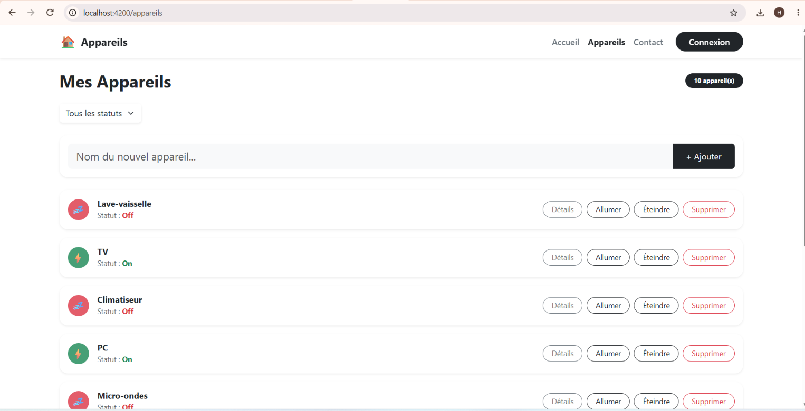
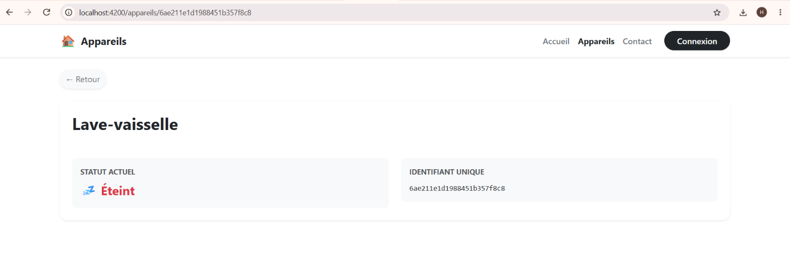

# 🏠 Appareils Manager — Application Full Stack

Une application web complète de gestion d'appareils électroménagers. Elle permet de lister, ajouter, modifier (allumer/éteindre), visualiser les détails et supprimer des appareils, avec persistance des données dans une base NoSQL.

Ce projet a été réalisé dans le cadre du **TP3 - Database & Deploy** (Angular, Express & MongoDB).

---

## 📸 Aperçu de l'application

### Interface principale (Dashboard)
*Liste des appareils, filtres par statut, boutons d'actions rapides et formulaire d'ajout.*



### Détail d'un appareil
*Page dédiée affichant les informations complètes d'un appareil grâce à son identifiant MongoDB.*



---

## 🏗️ Architecture du projet

Le projet est divisé en 3 parties principales, orchestrées par Docker :

- **`/front`** : L'application cliente (Angular + Bootstrap 5).
- **`/api`** : Le serveur backend (Node.js, Express, Mongoose, TypeScript).
- **`docker-compose.yml`** : Le chef d'orchestre qui lance le Front, le Back et la base de données en même temps.

### Stack Technique

| Domaine | Technologies |
| :--- | :--- |
| **Frontend** | Angular 22, Bootstrap 5, RxJS, Signals |
| **Backend** | Node.js 24, Express 5, TypeScript, Zod (validation), Helmet (sécurité) |
| **Base de données** | MongoDB 8, Mongoose |
| **Déploiement & Ops** | Docker, Docker Compose, Nginx |

---

## 🚀 Lancer le projet

### Méthode recommandée : Avec Docker (Production ready)

C'est la méthode la plus simple : elle ne nécessite que **Docker Desktop**.

1. Clonez ce dépôt.
2. Ouvrez un terminal à la racine du projet.
3. Lancez la commande magique :
   ```bash
   docker compose up -d --build